<!-- Banner layout inspired by https://github.com/Kyung-A/2020ver-portfolio; original SVG layout using the supplied portrait. -->

  <a href="https://kimyeonjuu.github.io/#project">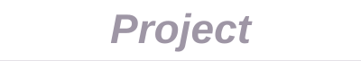</a>
  <a href="https://kimyeonjuu.github.io/#about">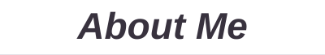</a>
  <a href="https://kimyeonjuu.github.io/#contact">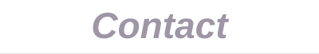</a>

메뉴를 누르면 포트폴리오 사이트에서 자세히 볼 수 있습니다.

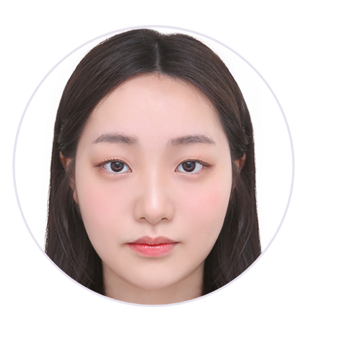

**김연주 · Yeonju Kim** 
국립한밭대학교 컴퓨터공학과 · 학사과정, 2023–현재 
AIM Lab. 학부연구생 · UST·KISTI 양자정보 연구인턴

**안녕하세요. 양자정보와 AI를 연구하는 김연주입니다.** 
흉부 X-ray 분류 연구를 시작으로, 영상의 주파수 특징을 골라 조절하는 방법을 설계하고 실험해 왔습니다. 
저는 성능이 얼마나 좋아졌는지만큼이나 무엇이 그 차이를 만들었는지 이해하는 것을 중요하게 생각합니다.

지금은 UST·KISTI에서 AI 모델의 일부 계산을 양자 회로로 바꾸고, 기존 모델과 같은 조건에서 분류 성능을 비교하고 있습니다.

앞으로는 양자컴퓨팅을 AI의 학습과 추론에 활용하는 연구를 이어가고 싶습니다. 
어떤 문제에서 양자 계산이 도움이 되는지 직접 구현하고 확인하며, 실제로 쓸 수 있는 방법을 찾는 것이 제 목표입니다.

**Pattern Recognition · SCIE 제1저자\*** · 2026.09 게재 승인 
* 공동 기여 표기 · [논문과 연구 내용 ↓](#selected-research)

 

GPA **4.35 / 4.50** · 석차 **2 / 112** (2026-1) · TOEIC **780** (2026.08.23) 
[학력·경력 전체 보기 ↗](https://kimyeonjuu.github.io/cv.html)

<h4>AI & Computer Vision </h4>

  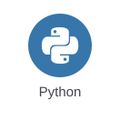
  
  
  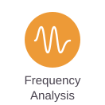
  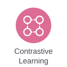
  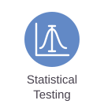

<h4>Quantum Computing </h4>

  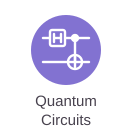
  
  
  

AI 연구에 사용한 도구와 방법입니다. 양자 항목은 UST·KISTI 인턴십에서 구현하며 실험 중인 주제입니다.

### 국제 학술지 논문 · Pattern Recognition

  
  

**Targeted Frequency Modulation for Robust Neonatal Respiratory Distress Classification** 
Accepted · 2026.09

신생아 흉부 X-ray에서 호흡곤란증후군을 더 잘 구분하고자 TFM을 만들었습니다. 
AI가 추출한 영상 특징을 주파수별로 나눈 뒤 일부를 골라 조절하는 방법입니다. 
직접 구현한 모델을 기존 방법과 비교하고 결과를 분석해 논문 초안을 작성했습니다.

**평가:** 신생아 흉부 X-ray 632장 · 5-fold 교차검증 
**결과:** AUROC 88.39 ± 4.46% · 정확도 82.45 ± 5.47% (5회 평가의 평균 ± 표준편차)

[논문 정보·DOI ↗](https://doi.org/10.1016/j.patcog.2026.115008) · [구현 코드·실행 안내 ↗](https://github.com/KimYeonJuu/Targeted-Frequency-Modulation-for-Robust-Neonatal-Respiratory-Distress-Classification)

공개 저장소에 TFM 모델 코드와 학습·평가 스크립트가 있습니다. 임상 영상과 학습 가중치는 포함하지 않습니다.

제1저자: 저자 목록 첫 번째, 공동 기여 표기. 저널 지표: 2025 JCR · Engineering, Electrical & Electronic · JIF percentile 93.4 기준.

<b>논문 저자 표기 확인</b>

---

### 국내 학술지 논문 · 공동제1저자

**대조 학습과 데이터 증강을 활용한 흉부 X-Ray 이미지 분류 정확도 향상** 
한국전기전자학회 논문지 · 29(3), 289–296 · **2025.09 게재**

비슷한 X-ray 특징은 가깝게 학습하도록 하고 밝기와 잘라내기 증강을 함께 적용했습니다.

| 평가 데이터 | 기존 정확도 | 적용 후 정확도 |
| :--- | ---: | ---: |
| CheXpert | 74.65% | **79.45%** |
| 외부 COVID·Pneumonia | 61.37% | **66.32%** |

[논문 정보·초록 ↗](https://doi.org/10.7471/ikeee.2025.29.3.289)

<b>게재 정보·공동제1저자 표기 확인</b>

<a href="assets/contrastive-authorship.png">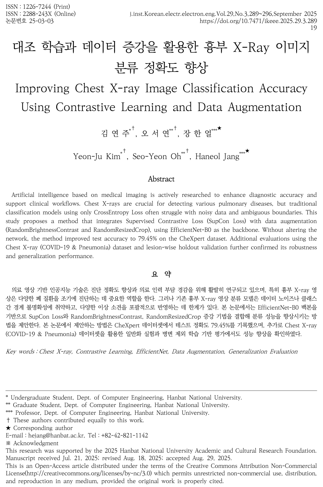</a>

---

### 연구인턴 · UST·KISTI

**양자정보 연구인턴 · 2026.07–현재 · 진행 중** 
UST·KISTI 스쿨 · 지도교수 류정희

**연구 주제: 양자 회로를 이용한 의료영상 분류**

흉부 X-ray 분류 모델에서 주파수를 고르는 계산과 채널별 가중치를 정하는 계산을 각각 양자 회로로 바꿔 비교하고 있습니다. 
학습·평가 데이터에 같은 환자가 섞인 문제를 찾아 환자 단위로 다시 나누고 모델을 재평가했습니다.

<a href="assets/quantum-method.png">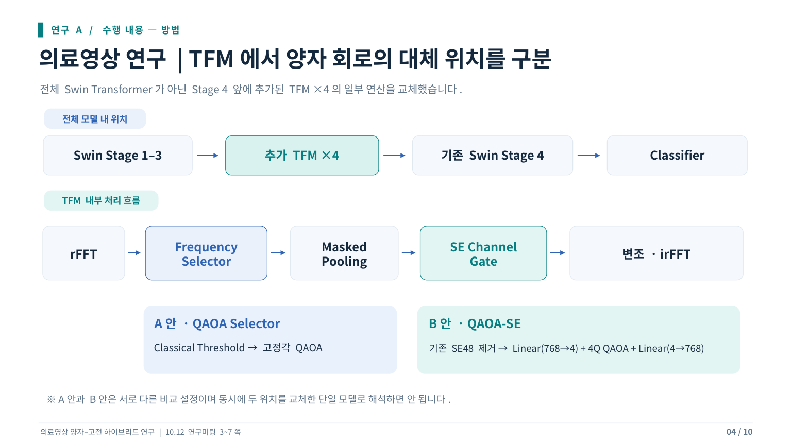</a>

<b>활동보고서 · 데이터 검증과 성능 비교</b>

**환자 단위 재분할 · 5쪽**

<a href="assets/quantum-validation.png">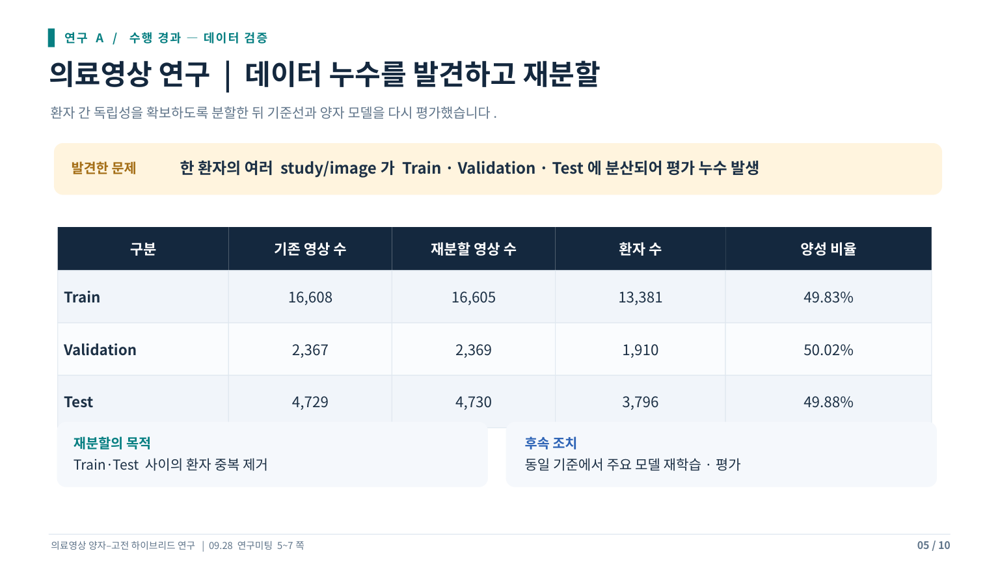</a>

**3개 시드 성능 비교 · 6쪽**

<a href="assets/quantum-results.png">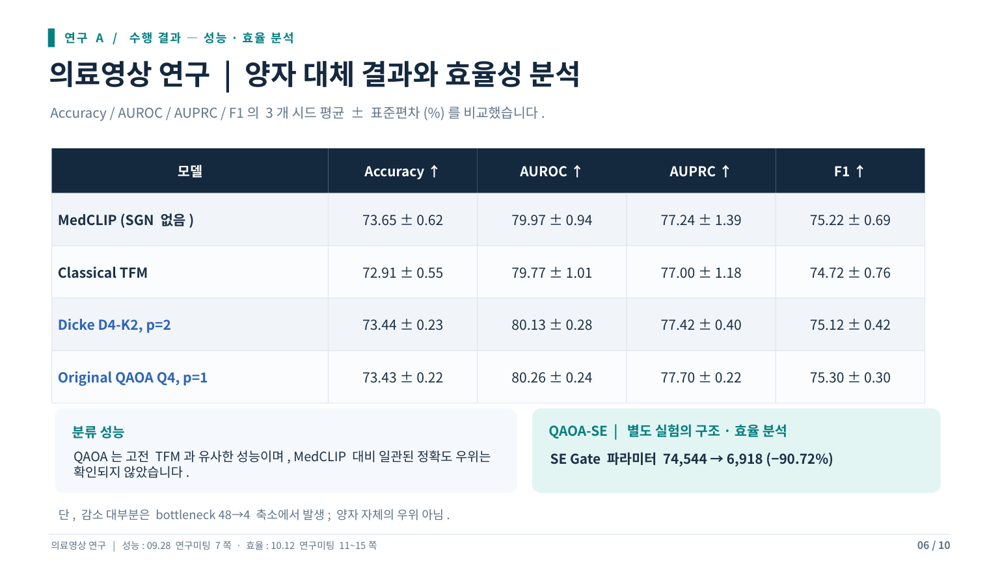</a>

QAOA 모델은 고전 TFM과 비슷한 성능을 보였습니다. MedCLIP 대비 일관된 정확도 우위는 확인하지 못했습니다. QAOA-SE의 파라미터 감소는 대부분 중간 차원을 48에서 4로 줄인 데서 발생했습니다.

---

**의료영상 AI → 주파수 특징 연구 → 양자·고전 하이브리드 모델** 
흉부 X-ray 분류와 주파수 조절 연구를 거쳐, 지금은 AI 모델에 양자 회로를 적용하고 있습니다.

| Experience | Work |
| :--- | :--- |
| **UST·KISTI 스쿨** · 양자정보 연구인턴 2026.07–현재 | 하계·장기 인턴십 · 지도교수 류정희 의료영상 AI 모델에 양자 회로를 적용하고 분류 결과 비교 |
| **AIM Lab.** · 학부연구생 | 의료영상 분류 · 대조학습 · 데이터 증강 선택적 주파수 조절 방법 설계와 검증 |
| **연구과제** · 학생연구자 2026.04.01–2026.10.31 | 생성형 AI 기반 이미지 워터마킹 기술 연구 |
| **연구과제** · 학생연구자 2025.04.01–2025.09.30 | 사이버안보 정책 도메인에 적합한 대화형 AI 모델 연구 |

<b>두 연구과제의 참여기간·역할 증빙</b>

<a href="assets/research-projects.png">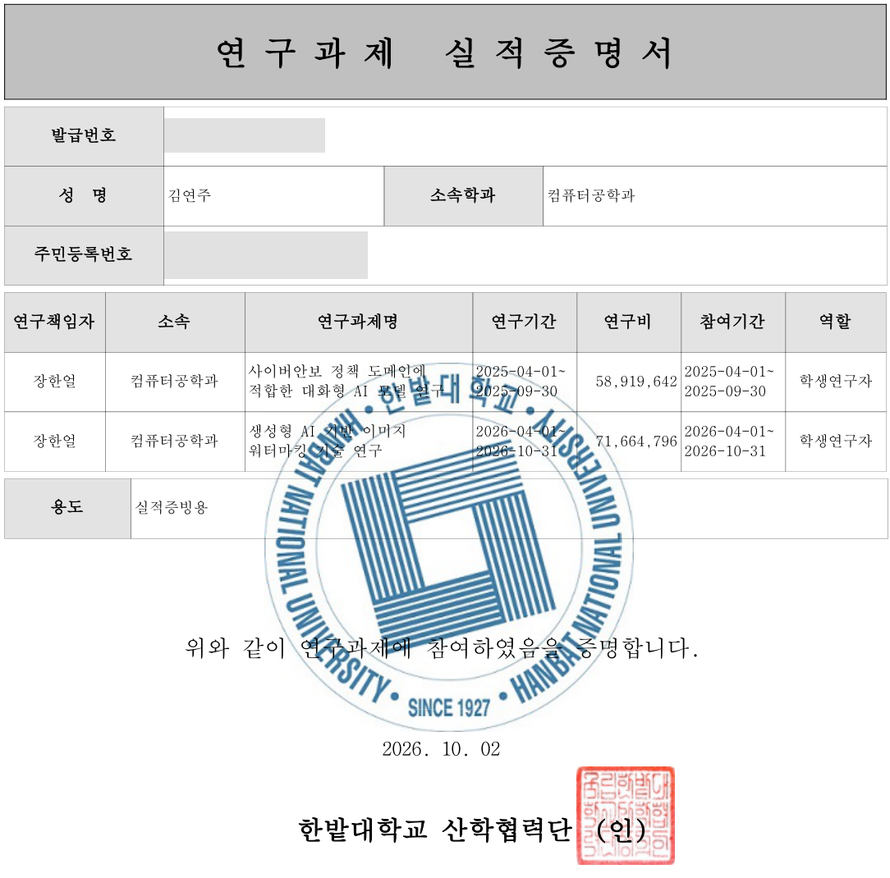</a>

2026.10.02 발급 · 주민등록번호와 발급번호를 가린 공개용 발췌본입니다.

| Year | Award | Work |
| :--- | :--- | :--- |
| **2025.12** | 🥇 **최우수상** 한국방송·미디어공학회 동계학술대회 대학생 및 고등학생 논문 경진대회 | 미세 병변 검출을 위한 블록 FFT 기반 선택적 주파수 증강 [연구 ↗](https://kimyeonjuu.github.io/research/frequency.html) · [상장 ↗](assets/frequency-award.webp) |
| **2025** | 🥉 **AI 부문 3등** 소중한 SW·AI 경진대회 | Fake Text Detection · 팀 4im [상장 ↗](assets/ai-award.png) |

  

<b>활동·성적 증빙 더 보기</b>

**UST·KISTI 장기인턴십 시스템**

**학업 성적**

**TOEIC · 780점**

<a href="assets/toeic-score.png">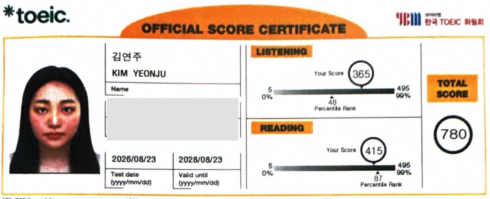</a>

**소중한 SW·AI 경진대회 · AI 부문 3등**

[전체 증빙 보기 ↗](https://kimyeonjuu.github.io/evidence.html)

  
  
  

✉️ **[yeonjuk8@gmail.com](mailto:yeonjuk8@gmail.com)**

Last updated · 2026.10.21
