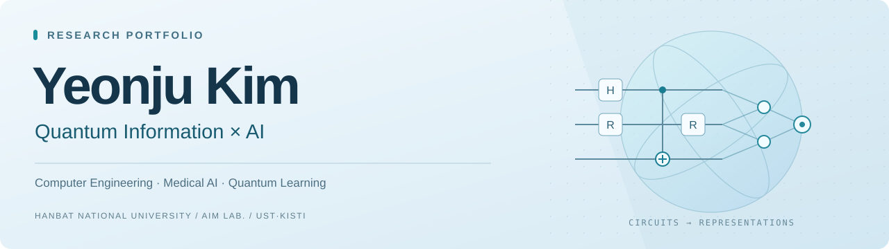
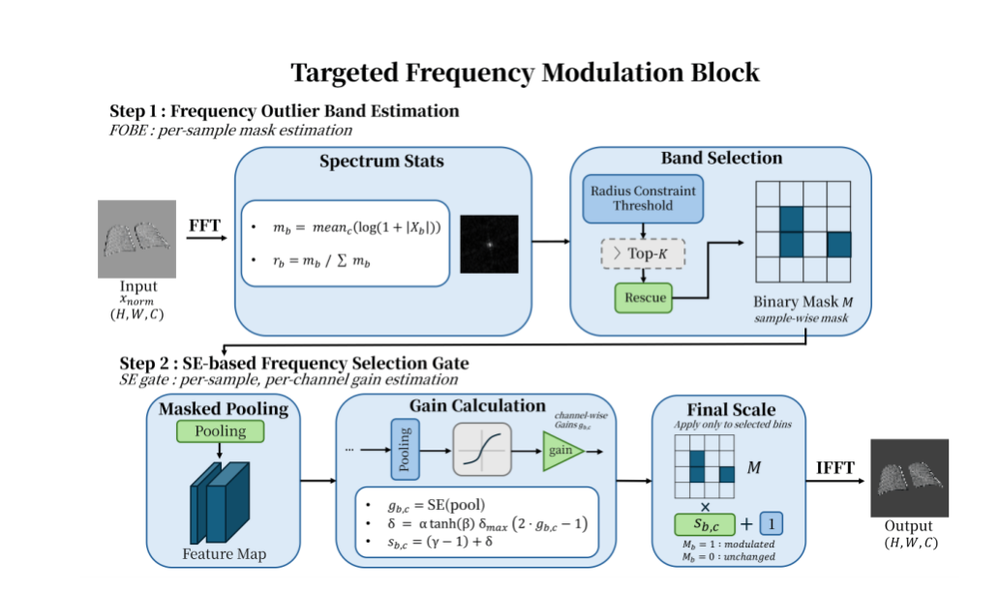
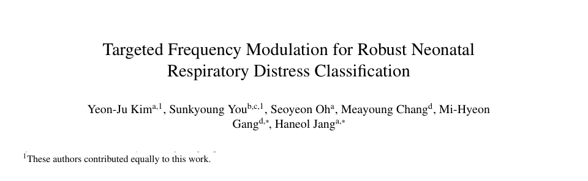
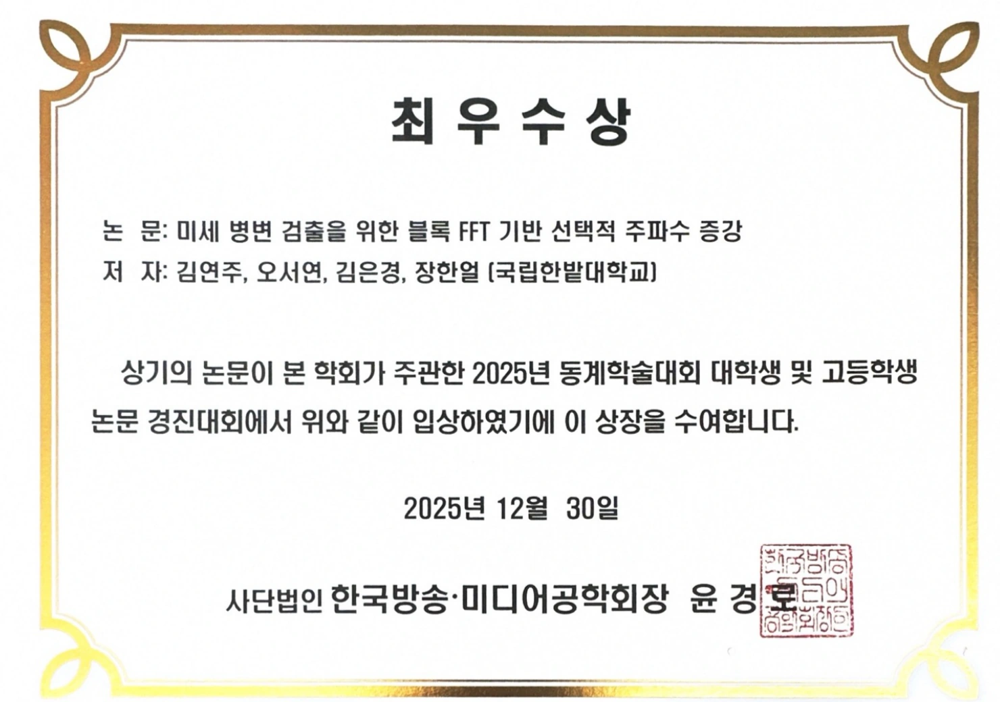
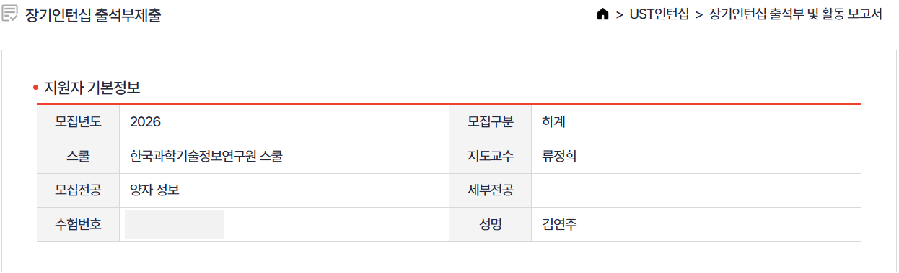
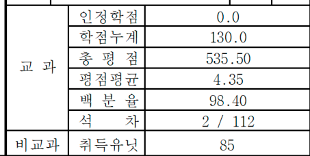
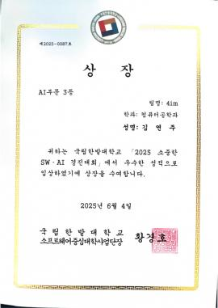

  
  
  

## Profile

**김연주 · Yeonju Kim** 
의료영상의 주파수 특징을 연구해 왔습니다. 지금은 양자 회로의 출력이 최종 예측에 어떻게 반영되는지 살펴보고 있습니다.

<table>
  <tr><td><b>Education</b></td><td>국립한밭대학교 컴퓨터공학과 · 학사과정, 2023–현재</td></tr>
  <tr><td><b>Research</b></td><td>UST·KISTI 양자정보 연구인턴 · AIM Lab. 학부연구생</td></tr>
  <tr><td><b>Academic</b></td><td>GPA <b>4.35 / 4.50</b> · 석차 <b>2 / 112</b> (2026-1 기준)</td></tr>
  <tr><td><b>Focus</b></td><td>Quantum Information · Quantum–Classical Models · Medical AI</td></tr>
</table>

## Selected Research

### Pattern Recognition · Elsevier

  
  

**[Targeted Frequency Modulation for Robust Neonatal Respiratory Distress Classification](https://kimyeonjuu.github.io/research/tfm.html)** 
Accepted · 2026.09

신생아 흉부 X-ray에서 주파수 대역을 선택하고 조절하는 TFM을 설계했습니다. 
방법 설계부터 구현, 비교 실험, 통계 검정과 논문 초안 작성을 맡았습니다.

[연구 자세히 보기 ↗](https://kimyeonjuu.github.io/research/tfm.html) · [Code ↗](https://github.com/KimYeonJuu/Targeted-Frequency-Modulation-for-Robust-Neonatal-Respiratory-Distress-Classification)

제1저자: 저자 목록 첫 번째, 공동 기여 표기. 저널 지표: 2025 JCR · Engineering, Electrical & Electronic · JIF percentile 93.4 기준.

<b>논문 저자 표기 확인</b>

**대조 학습과 데이터 증강을 활용한 흉부 X-Ray 이미지 분류 정확도 향상** 
한국전기전자학회 논문지, 29(3), 289–296 · **공동제1저자** · 2025.09 
[Paper ↗](https://doi.org/10.7471/ikeee.2025.29.3.289) · [연구 자세히 보기 ↗](https://kimyeonjuu.github.io/research/contrastive.html)

## Research Experience

**의료영상 AI → 주파수 특징 연구 → 양자·고전 하이브리드 모델** 
모델을 구현하고 비교 실험으로 확인하는 경험을 쌓아 양자정보·AI 연구로 이어가고 있습니다. [진로 로드맵 ↗](https://kimyeonjuu.github.io/journey.html)

| Experience | Work |
| :--- | :--- |
| **UST·KISTI 스쿨** · 양자정보 연구인턴 2026.07–현재 | 하계·장기 인턴십 · 지도교수 류정희 양자 회로 출력과 하이브리드 모델의 최종 예측 분석 · [자세히 ↗](https://kimyeonjuu.github.io/research/quantum.html) |
| **AIM Lab.** · 학부연구생 2024–현재 | 의료영상 분류 · 대조학습 · 데이터 증강 선택적 주파수 조절 방법 설계와 검증 |
| **연구과제** · 학생연구자 2026.04–현재 | 생성형 AI 기반 이미지 워터마킹 기술 연구 |
| **연구과제** · 학생연구자 2025.04–09 | 사이버안보 정책 도메인에 적합한 대화형 AI 모델 연구 |

## Awards

| Year | Award | Work |
| :--- | :--- | :--- |
| **2025.12** | 🥇 **최우수상** 한국방송·미디어공학회 동계학술대회 대학생 및 고등학생 논문 경진대회 | 미세 병변 검출을 위한 블록 FFT 기반 선택적 주파수 증강 [연구 ↗](https://kimyeonjuu.github.io/research/frequency.html) · [상장 ↗](assets/frequency-award.webp) |
| **2025** | 🥉 **AI 부문 3등** 소중한 SW·AI 경진대회 | Fake Text Detection · 팀 4im [상장 ↗](assets/ai-award.png) |

  

<b>활동·성적 증빙 더 보기</b>

**UST·KISTI 하계·장기 인턴십**

**학업 성적**

**소중한 SW·AI 경진대회 · AI 부문 3등**

[전체 증빙 보기 ↗](https://kimyeonjuu.github.io/evidence.html)

## Skills & Contact

  
  
  
  

비교 실험 · 통계 검정 · 연구 시각화 
TOEIC **780** (2026.08.23)

✉️ **[yeonjuk8@gmail.com](mailto:yeonjuk8@gmail.com)** · [Portfolio](https://kimyeonjuu.github.io/) · [CV](https://kimyeonjuu.github.io/cv.html)

Last updated · 2026.10.16
